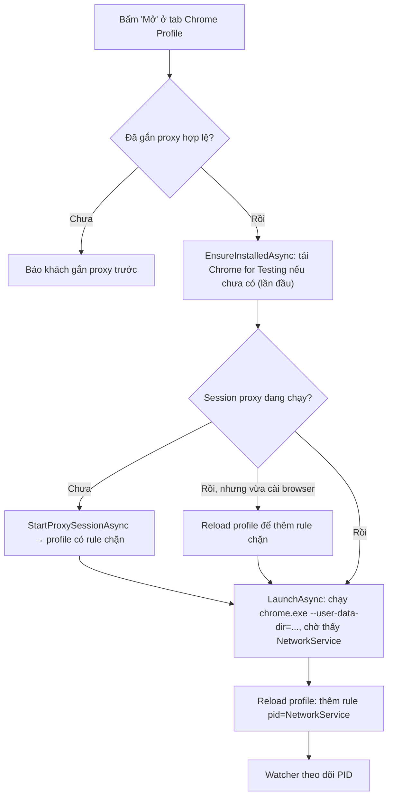

# 09. Chrome Profile — mỗi profile Chrome một proxy

> Đọc xong tài liệu này bạn sẽ hiểu: tab "Chrome Profile" hoạt động thế nào, vì sao tool phải mang theo **trình duyệt riêng** thay vì dùng Chrome đã cài trên máy, Proxifier được cấu hình ra sao để **không bao giờ lộ IP thật**, và cách test tính năng này.

Nên đọc trước [04-application-proxy-assignment.md](04-application-proxy-assignment.md) (app theo path, giả lập theo PID) và [05-proxifier-integration.md](05-proxifier-integration.md) (Proxification Rule).

## 1. Bài toán

Khách muốn mở nhiều Chrome profile, mỗi profile có cookie/tài khoản đăng nhập riêng và **đi qua đúng 1 proxy riêng**. Hai cách gán proxy sẵn có đều không làm được:

- **Theo path `chrome.exe`**: mọi profile chạy chung 1 file exe → tất cả đi chung 1 proxy.
- **Profile Chrome thông thường** (`Profile 1`, `Profile 2` trong cùng thư mục `User Data`): dùng chung 1 browser process và 1 process mạng → ở tầng hệ điều hành Proxifier không tách được.

Giải pháp: mỗi profile là **1 instance Chrome riêng** với `--user-data-dir` riêng → mỗi profile có cây process riêng, PID riêng.

## 2. Những gì đã kiểm chứng thực tế (spike, Proxifier 4.14 + Chrome 155)

| Rule Proxifier | Kết quả |
|---|---|
| `pid=<browser process gốc>` | ❌ ra IP thật — rule `pid=` **không** áp dụng cho process con |
| `pid=<NetworkService>` | ✅ đúng proxy — toàn bộ traffic Chrome đi qua 1 process con `--utility-sub-type=network.mojom.NetworkService` |
| Kill NetworkService (giả lập crash/sleep) | ⚠️ Chrome tự respawn với **PID mới** → rule cũ không còn khớp → nếu không có lớp chặn thì rơi xuống `Default → Direct` = **lộ IP thật** |
| Thêm rule `"<chrome.exe của tool>" → Block` ngay dưới các rule PID | ✅ trong lúc PID chưa cập nhật, Chrome bị **chặn mạng** (`ERR_ADDRESS_INVALID`) thay vì lộ IP; Chrome cá nhân của khách không bị ảnh hưởng |

Vì rule chặn bắt theo **đường dẫn exe**, nó không được trỏ vào Chrome đã cài sẵn (sẽ chặn luôn Chrome cá nhân của khách). Do đó tool tải về **Chrome for Testing** (bản Chrome chính thức dạng zip của Google) vào thư mục riêng `%AppData%\ProxyManager\browser\<version>\` và chỉ chặn đường dẫn đó.

## 3. Kiến trúc

Chrome profile **không phải entity mới** — nó là 1 `ApplicationRule` với `TargetType = ApplicationTargetType.ChromeProfile`, nên dùng lại toàn bộ luồng sẵn có: sinh profile Proxifier, start/stop session, auto-reload, gỡ proxy hết hạn, form gắn proxy.

| Field của `ApplicationRule` | Ý nghĩa với Chrome profile |
|---|---|
| `ChromeProfileName` | Tên khách đặt (hiển thị) |
| `ChromeUserDataDirectory` | **Định danh bền vững** — `%AppData%\ProxyManager\chrome-profiles\<rule id>` |
| `ProcessId` | **Định danh runtime** — PID của NetworkService; `null` khi profile đang đóng |
| `AssignedProxyId` / `IsEnabled` | Như rule thường; `IsEnabled = true` khi đã gắn proxy hợp lệ |

Giống giả lập: *thư mục dữ liệu* = "đây là profile nào" (không đổi), *PID NetworkService* = "đang chạy ở đâu" (đổi mỗi lần mở/respawn).

### Các class

| Class | Tầng | Vai trò |
|---|---|---|
| `ChromeProfileService` | Core | Tạo profile, mở (`LaunchAsync`), đóng êm (`CloseAsync` — gửi WM_CLOSE, quá 6s mới kill), xoá dữ liệu, `RefreshRuntimeTargetsAsync` gán PID NetworkService vào rule |
| `ChromeProfileProcessClassifier` | Core | Từ danh sách process `chrome.exe` → nhóm theo `--user-data-dir`, tìm browser process và NetworkService. Chỉ nhận process chạy từ exe của tool |
| `WmiChromeProfileProcessScanner` | Core | Lấy command line các process `chrome.exe` qua WMI rồi đưa cho classifier |
| `ChromeNetworkServiceWatcher` | Core | Theo dõi sự kiện **exit** của từng NetworkService → bắn `RuntimeChanged` sau ~1,2s (debounce); tick dự phòng mỗi 30s |
| `ProxifierProfileBuilder` | Core | Rule `pid=<NetworkService>` cho profile đang mở; **bỏ qua** profile đang đóng (không throw như giả lập); thêm rule chặn từ `ProxifierProfileModel.BlockedExecutablePaths` |
| `ProxifierSessionService` | Core | Truyền `IChromeBrowserProvisioner.GetInstalledExecutablePaths()` làm `BlockedExecutablePaths` → mọi lần start/reload đều có rule chặn |
| `ApplicationRuleService` | Core | `Get/SaveApplicationRulesAsync` và `Get/SaveChromeProfilesAsync`: 2 tab dùng chung 1 file rule nhưng mỗi tab chỉ ghi phần của mình |
| `ChromeBrowserProvisioner` | Infrastructure | Tải zip Chrome for Testing, **kiểm SHA-256** (không cấu hình hash → không cài), giải nén vào thư mục tạm rồi mới đổi tên thành `<version>` |
| `ChromeProfilesControl` / `ChromeProfileNameForm` | App | Tab "Chrome Profile" và form đặt tên |

### Thứ tự rule trong profile Proxifier

```
1. Localhost                              → Direct
2. <rule app thường / giả lập>            → Proxy
3. pid=<NetworkService profile đang mở>   → Proxy được gắn
4. "<chrome.exe của tool>"                → Block   ← leak guard (tên rule: "Chrome Profile leak guard")
5. Default                                → Direct / Block
```

Proxifier dừng ở rule đầu tiên khớp, nên mọi process Chrome của tool **không** khớp rule PID nào (NetworkService vừa respawn, Chrome mở tay ngoài tool, profile chưa gắn proxy) đều bị chặn.

## 4. Các luồng chính

### Mở profile (`MainForm.OpenChromeProfileAsync`)



**Thứ tự quan trọng:** session (kèm rule chặn) luôn chạy **trước** khi Chrome khởi động, nên từ request đầu tiên Chrome đã bị chặn hoặc đi đúng proxy — không có khoảnh khắc nào đi thẳng.

### NetworkService đổi PID (crash, sleep/wake, khách đóng Chrome)

Watcher bắt sự kiện exit → `MainForm.SyncChromeRuntimeAsync` quét lại → nếu PID đổi thì lưu và reload profile Proxifier. Trong lúc chờ (~4–6s đo thực tế, phần lớn là thời gian Proxifier nạp profile) Chrome bị chặn mạng, **không lộ IP**. Nếu browser còn sống nhưng NetworkService chưa kịp respawn, watcher hẹn quét lại sau 1,5s.

### Dừng proxy / thoát app / khởi động app

Khi Proxifier không chạy, Chrome của tool sẽ đi thẳng ra mạng. Vì vậy:

- **Bấm "Dừng"**: nếu đang có Chrome profile mở → hỏi xác nhận rồi **đóng hết** trước khi dừng (`CloseChromeProfilesBeforeStopAsync`). Khách chọn "Không" → không dừng.
- **Thoát app**: đóng hết Chrome profile, không hỏi.
- **Khởi động app** (session luôn ở trạng thái Dừng) và **mỗi lần watcher bắn khi session đang Dừng**: Chrome của tool nào còn chạy sẽ bị đóng kèm thông báo (`CloseUnprotectedChromeProfilesAsync`).

### Đổi proxy khi profile đang mở

Rule PID được cập nhật ngay, nhưng kết nối Chrome đã mở trước đó vẫn có thể dùng proxy cũ cho tới khi bị đóng → tab hỏi khách có muốn **khởi động lại** Chrome của profile đó không.

### Đăng xuất

Profile khi đăng xuất bị gỡ các proxy mua từ backend (`RemoveLogoutBackendAssignments`) → Chrome profile đang dùng proxy backend sẽ **bị chặn mạng** (rơi vào rule chặn), không lộ IP.

## 5. Cấu hình trình duyệt

`appsettings.json`:

```json
"ChromeBrowser": {
  "Version": "155.0.8059.84",
  "DownloadUrl": "https://storage.googleapis.com/chrome-for-testing-public/155.0.8059.84/win64/chrome-win64.zip",
  "Sha256": "507f2a03...afde",
  "InstallDirectory": "%AppData%\\ProxyManager\\browser",
  "ExecutableRelativePath": "chrome-win64\\chrome.exe",
  "DownloadTimeoutSeconds": 1800
}
```

**Nâng phiên bản trình duyệt:**

1. Lấy URL bản mới tại `https://googlechromelabs.github.io/chrome-for-testing/last-known-good-versions-with-downloads.json` (kênh `Stable`, platform `win64`).
2. Tải zip về, tính hash: `Get-FileHash chrome-win64.zip -Algorithm SHA256`.
3. Sửa **cả 3** giá trị `Version`, `DownloadUrl`, `Sha256` cùng lúc.

Lần mở profile tiếp theo tool sẽ tải bản mới. Bản cũ được xoá nếu không còn Chrome nào chạy từ nó (Windows không cho đổi tên thư mục đang dùng → tool bỏ qua, không xoá dở). Trong lúc bản cũ còn trên đĩa, rule chặn và scanner vẫn bao cả bản cũ (`GetInstalledExecutablePaths`).

## 6. Giới hạn đã biết / việc cần chốt

- **Chrome for Testing không có chữ ký số** (đã kiểm tra `Get-AuthenticodeSignature` → `NotSigned`). Tool tự tải bằng `HttpClient` nên file không mang Mark-of-the-Web và SmartScreen không chặn, nhưng antivirus có thể cảnh báo. Cân nhắc host zip trên CDN của HomeProxy (sửa `DownloadUrl`) và/hoặc ký lại.
- Chrome for Testing **không tự cập nhật** — phải nâng version theo mục 5 định kỳ để vá bảo mật. Có thanh thông báo "Chrome for Testing" trên cửa sổ, có thể thiếu một số codec/DRM (Netflix...).
- Chỉ đổi IP, **chưa** giả lập fingerprint trình duyệt như các tool antidetect.
- Nếu Proxifier bị tắt từ bên ngoài trong khi session vẫn đang ở trạng thái "Đang dùng proxy" (không phải trạng thái Dừng), tool chưa phát hiện để đóng Chrome.
- Nút "Xem ứng dụng đang dùng proxy này" ở các tab proxy chỉ nhảy sang tab "Ứng dụng"; Chrome profile dùng proxy đó vẫn được liệt kê trong cột ứng dụng nhưng không có nút nhảy sang tab "Chrome Profile".
- Chưa giới hạn số profile theo gói.

## 7. Test

**Unit test** (chạy `dotnet test src/NetAgent.ProxyManager.Tests/NetAgent.ProxyManager.Tests.csproj`):

| File | Khoá lại hành vi |
|---|---|
| `ChromeProfileRoutingTests` | Rule PID cho profile mở, bỏ qua profile đóng, vị trí rule chặn, eligibility, 2 tab không ghi đè rule của nhau, session truyền đường dẫn chặn |
| `ChromeProfileProcessClassifierTests` | Nhóm process theo `--user-data-dir` (các kiểu quote), bỏ qua Chrome cá nhân |
| `ChromeProfileServiceTests` | Tạo/xoá profile (không bao giờ xoá ngoài thư mục gốc), gán/xoá PID runtime, tham số khởi chạy |
| `ChromeBrowserProvisionerTests` | Tải + kiểm SHA-256 + giải nén, từ chối khi sai/thiếu hash và không để lại rác, dọn bản cũ |

**Checklist test tay** (máy có Proxifier + 2 proxy test khác IP):

1. Tạo 2 profile, gắn 2 proxy khác nhau, mở cả 2 → vào `https://api.ipify.org` ở mỗi cửa sổ thấy đúng IP proxy tương ứng.
2. Mở Chrome cá nhân của máy trong lúc tool đang chạy → vẫn ra IP thật, dùng bình thường.
3. Task Manager → kill process "Network Service" của 1 profile (Chrome → Shift+Esc để thấy) → vài giây đầu trang không tải được, sau đó tự đúng proxy lại; không lúc nào ra IP thật.
4. Sleep máy rồi bật lại → các profile vẫn đúng proxy.
5. Bấm "Dừng" khi có profile đang mở → có hộp thoại hỏi, đồng ý thì Chrome của tool đóng hết.
6. Đổi proxy khi profile đang mở → được hỏi khởi động lại; sau khi mở lại ra IP mới.
7. Kiểm tra rò rỉ WebRTC/DNS ở `https://browserleaks.com/webrtc` và `https://browserleaks.com/dns` → không thấy IP thật.
8. Xoá profile → thư mục `%AppData%\ProxyManager\chrome-profiles\<id>` biến mất.

## Đọc tiếp

- [05-proxifier-integration.md](05-proxifier-integration.md) — Proxifier và Proxification Rule.
- [06-build-and-release.md](06-build-and-release.md) — build & phát hành.
